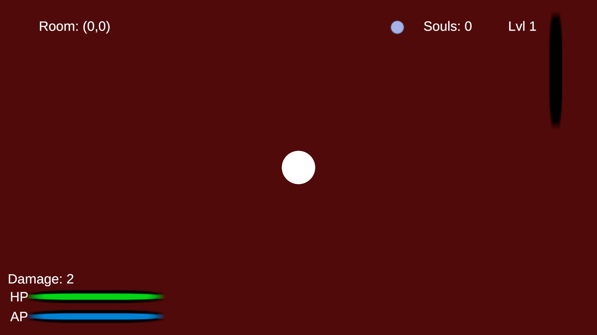

# Chief of Sin

**A top-down, room-based roguelite made with Unity 6 and C#.** The playable MVP is a complete Gluttony boss route: explore Hell, clear rooms, develop your ghost, collect clues, and defeat Gluttony.

[Play or download the MVP on itch.io](https://l1me0n.itch.io/chief-of-sin) · [Read the detailed MVP implementation notes](README_MVP_READY.md)

## What is in the MVP

- Mouse-aimed ectoplasm combat and a timed defensive Disappear ability.
- A grid of rooms with combat, campfires, challenges, a merchant, and the Gluttony boss encounter.
- Five enemy families, deterministic encounters, and room state that persists across visits.
- XP, Souls, four upgrade branches, trade items, checkpoints, and save/load.
- Four challenge types and a clue trail that unlocks the Gluttony boss fight and MVP ending.

**Scope:** This build completes the Gluttony vertical slice. The remaining Sin bosses, Horsemen fights, and final Lucifer boss belong to the longer-term design; they are not playable in this MVP. Lucifer does appear in a challenge room.

## Engineering highlights

- **Room streaming:** The active room is instantiated at runtime, while other rooms keep lightweight state keyed by map coordinates.
- **Persistent runs:** Room visits, encounters, progression, challenge outcomes, inventory, and boss progress can be restored from save data.
- **Encounter and boss flow:** Room difficulty, enemy combinations, clue rewards, and the Gluttony unlock are handled by separate systems.

Some useful entry points in the C# code:

| System | Code |
| --- | --- |
| Room transitions and world state | [`RoomManager.cs`](Assets/Scripts/Rooms/Runtime/RoomManager.cs), [`RoomState.cs`](Assets/Scripts/Rooms/Data/RoomState.cs) |
| Run persistence | [`RunSaveManager.cs`](Assets/Scripts/Save/RunSaveManager.cs) |
| Gluttony progression | [`BossProgressionManager.cs`](Assets/Scripts/Bosses/BossProgressionManager.cs) |

## Open the Unity project

1. Clone or download this repository.
2. Open the project folder in Unity Hub with **Unity 6000.3.10f1** (the version in `ProjectSettings/ProjectVersion.txt`).
3. Open `Assets/Scenes/RoomRuntime.unity` and press Play.

For room rules, controls, systems, and known MVP limitations, see [the detailed MVP notes](README_MVP_READY.md). The earlier full-game blueprint is retained in the repository's Git history.
